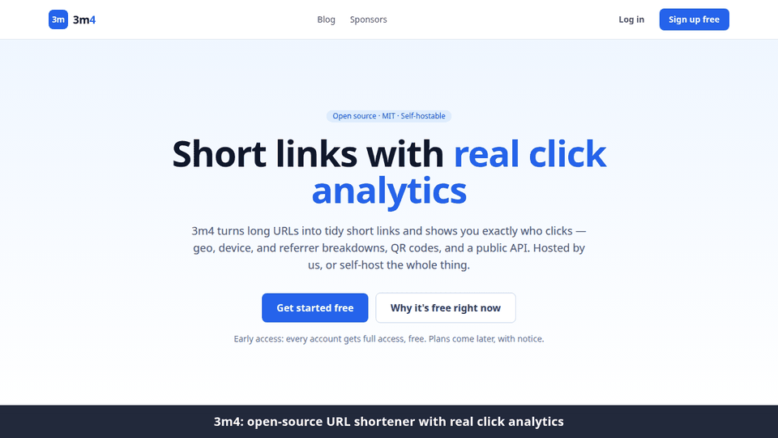

# 3m4

**Open-source URL shortener with real click analytics.** Short codes, custom
domains, 301/302 redirects, geo/device/referrer analytics, QR codes, and a public
API — self-hostable under the MIT license.

> Built by Enrique Magallon Alvarez. Hosted edition runs at `3m4.net`; the core is
> free to self-host on your own infrastructure.



---

## Why 3m4

- **Clicks are the product.** Usage is metered on two monthly metrics — links
  created and *tracked clicks* — because clicks are the real cost and the real value.
- **Accurate analytics by default.** Links default to `302` so every click is
  counted; opt a link into `301` when you want permanent/cached behavior.
- **Self-host friendly.** The open-source build runs without any billing provider.
- **Stateless & portable.** Plain Docker, Postgres as the source of truth — scale
  from one VPS to a load-balanced fleet without rewrites.

## Architecture

```
Caddy (reverse proxy, auto-HTTPS)
 ├─ web        Qwik City (Bun)   landing + /info + /blog + /projects + /sponsors + dashboard
 ├─ redirect   Flask (hot path)  GET /<code> → enqueue click → 301/302
 ├─ api        Flask             auth, links, analytics, domains, billing webhooks, metering
 ├─ mcp        Node (MCP)        AI-agent access: tools over the API, RBAC, approvals, audit
 └─ worker     Celery            click enrichment (geo/device/referrer), rollups, retention
      Postgres (source of truth) · Redis (cache + queue)
```

Shared core lives in [`dbcore/`](dbcore/) (models, plans, code generation, metering)
and is imported by all three Python services. The interface contract is
[`CONTRACT.md`](CONTRACT.md); the full design is [`PROJECT_PLAN.md`](PROJECT_PLAN.md).

```
dbcore/            shared Python core (models, plans, codegen, usage, privacy)
services/api/      Flask REST API
services/redirect/ Flask redirect service
services/worker/   Celery worker + beat
apps/web/          Qwik City frontend (Bun)
packages/mcp-server/  MCP server (npm: 3m4-mcp) — stdio + Streamable HTTP
packages/shared/   plan_limits.json, reserved_slugs.json, api_key_roles.json (single source of truth)
deploy/            docker-compose, Caddyfile
db/                Alembic scaffold for future migrations
```

## Quick start (Docker)

```bash
cp .env.example .env        # then edit secrets (JWT_SECRET_KEY, IP_HASH_SALT, ...)
make up                     # build + start everything; runs migrations & seeds
# open http://localhost:8080
```

The `migrate` service creates tables and seeds the reserved slugs (including the
`/resume` → https://enrique-magallon.com redirect) before the app starts.

### Self-host (no billing)

```bash
# sets BILLING_ENABLED=false; RevenueCat is never contacted, paywalls hidden
make up-selfhost
```

## Common tasks

| Command | Does |
|---|---|
| `make up` / `make down` | start / stop the full stack |
| `make up-selfhost` | start without billing |
| `make logs` | tail all logs |
| `make seed` | re-seed reserved slugs |
| `make build` | rebuild images |
| `make ps` | service status |
| `make e2e` | run the Playwright end-to-end suite against the running stack |

## Tests

End-to-end tests live in [`e2e/`](e2e/) (Playwright, Bun). They run against a
running stack (`make up`), cover the critical paths (sign-up/login, links +
redirects + analytics, API keys/RBAC, remote MCP, early-access surfaces) and
run in CI on every pull request via `.github/workflows/e2e.yml`.

```bash
make e2e                      # or: cd e2e && bun install && bun run test
```

## Configuration

All config is environment-driven — see [`.env.example`](.env.example). Key values:
`DATABASE_URL`, `REDIS_URL`, `JWT_SECRET_KEY`, `IP_HASH_SALT`, `BILLING_ENABLED`,
`REVENUECAT_WEBHOOK_AUTH_TOKEN`, `POSTHOG_API_KEY`, `RESUME_REDIRECT_URL`.

## AI agents (MCP)

3m4 ships an [MCP](https://modelcontextprotocol.io) server so agents can
shorten links, pause them and read analytics on your behalf — see
[`packages/mcp-server`](packages/mcp-server/). API keys carry a **role**
(viewer / editor / admin → scopes) enforced by the API, mirrored by the MCP
server (a read-only key never sees `delete_link`), and every mutation or
denial lands in an append-only **audit log** (`GET /api/account/audit`).
Destructive tools require **human confirmation**.

```bash
claude mcp add 3m4 --scope user --env M4_API_KEY=m4_live_… -- npx -y 3m4-mcp
# or remote: claude mcp add --transport http 3m4 https://3m4.net/mcp --header "Authorization: Bearer m4_live_…"
```

## Feature flags per environment

Resolution order, first match wins:

1. `FEATURE_FLAG_OVERRIDES=site-building=on,signups=off` — pin flags from the
   environment (any env, mostly local/CI).
2. No `POSTHOG_API_KEY` (local, self-host) — every flag ON, except flags with
   an explicit `self_host` value in
   [`packages/shared/feature_flags.json`](packages/shared/feature_flags.json)
   (`site-building` is off). No analytics calls are made.
3. `POSTHOG_API_KEY` set (production) — whatever the PostHog dashboard says,
   falling back to each flag's `default` if PostHog is unreachable.

So local never touches PostHog, and production flags are managed in PostHog.

## Privacy

Raw IP addresses are **never stored**. The worker uses the IP transiently for geo
lookup, stores only a salted hash and coarse geo, then discards it.

## Scaling path

Single VPS → vertical scale → externalize Postgres/Redis (managed + replica) →
multiple stateless `api`/`redirect` instances behind a load balancer → CDN/edge →
ClickHouse for clicks if volume demands it. See `PROJECT_PLAN.md §9`.

## License

[MIT](LICENSE) © 2026 Enrique Magallon Alvarez.
